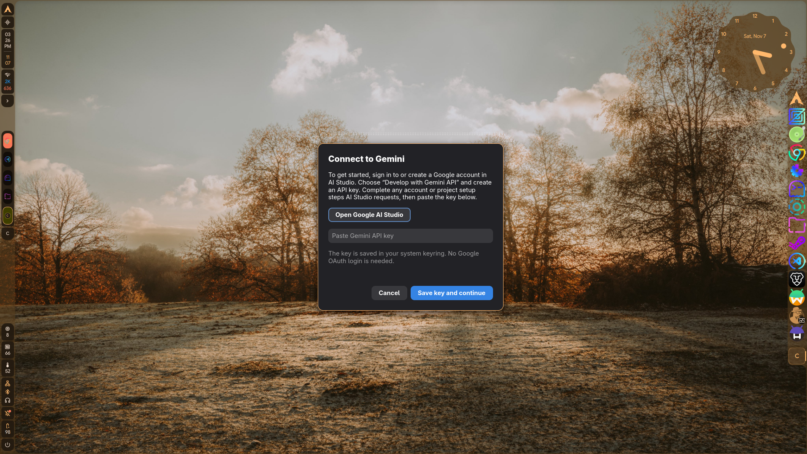
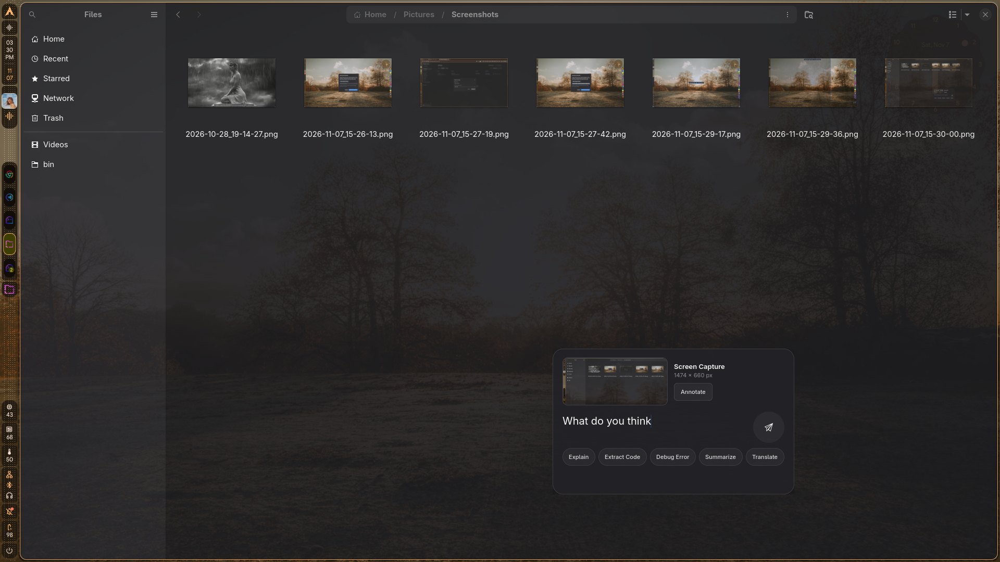
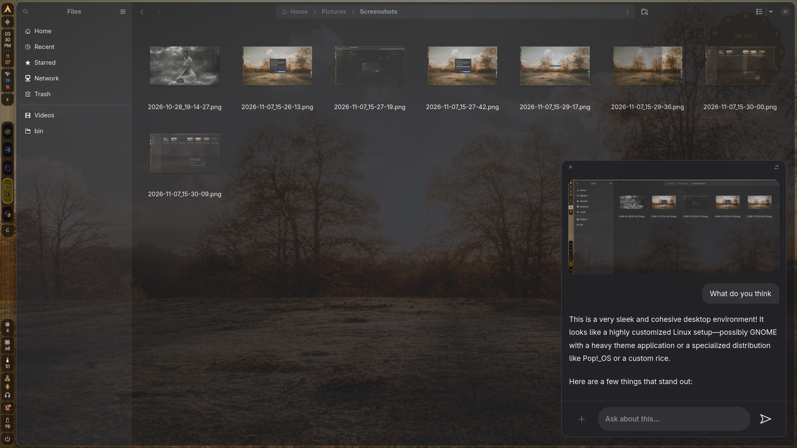

# Magic Pointer v2

Magic Pointer v2 is a native Linux desktop assistant for asking questions about
what is visible on screen. Select a region, type a question, and receive a
streamed Gemini response in a GTK chat window. The selected image and the
conversation are sent to Google's Gemini API; the application does not
currently run a local vision or language model.

This README describes the implementation that exists in this repository today.
It is not a description of a planned daemon, general-purpose desktop agent, or
compositor-independent product.

For a deeper plain-text overview of the project's scope, implementation,
technology, and runtime boundaries, see [description.txt](./description.txt).

## Contents

- [Project vision and current scope](#project-vision-and-current-scope)
- [Screenshots](#screenshots)
- [Features](#features)
- [How a request works](#how-a-request-works)
- [Architecture](#architecture)
- [Technology stack](#technology-stack)
- [Requirements](#requirements)
- [Build and run](#build-and-run)
- [Gemini API key setup](#gemini-api-key-setup)
- [Using the application](#using-the-application)
- [Settings](#settings)
- [Configuration and data handling](#configuration-and-data-handling)
- [Project layout](#project-layout)
- [Development and testing](#development-and-testing)
- [Current limitations](#current-limitations)
- [License](#license)

## Project vision and current scope

The project is focused on making visual context easy to discuss during normal
desktop work. Rather than requiring the user to describe or manually upload
what is on screen, Magic Pointer provides a screen-region selection flow and
attaches the resulting capture to a natural-language request.

The current application is an **interactive, user-triggered GTK application**
for a **Wayland desktop running Hyprland**. It combines:

1. Hyprland IPC for cursor position and active-window metadata.
2. GTK4 and GTK4 Layer Shell for the selection surface and prompt composer.
3. `libwayshot` for screen-region capture into an in-memory image.
4. Gemini's streaming HTTP API for multimodal responses.
5. A GTK chat window for the conversation and follow-up requests.

The selected region is chosen by the user for each initial request. Additional
regions can be captured and attached to follow-up messages. Optional
spatial-intelligence settings can add hardware information, the active-window
title, and user-entered context to requests.

## Screenshots

### First-run API key setup



### Capture prompt and quick actions


### Asking about a selected capture



### Streaming chat response



## Features

### Screen selection and capture

- Opens a fullscreen, transparent GTK Layer Shell surface for selection.
- **Spacebar mode switcher**: Press **Space** to toggle between:
  - *Window Snap*: Automatically spotlights and locks to the window under the
    cursor; click to capture.
  - *Region Selection*: Pure freeform rectangular drag selection.
  - *Full Monitor*: Spotlights the whole monitor; one click captures everything.
- **Tab / Scroll window cycling**: When windows overlap under the cursor, press
  **Tab** (or **Shift+Tab**) or scroll the mouse wheel to cycle down through the
  stacked window layers.
- **Edge snapping magnetism**: While dragging a custom region, selection edges
  subtly snap to nearby window and screen borders within 10 pixels with visual
  alignment guidelines.
- Hover over any open window to automatically snap and spotlight its bounding
  box with a title/dimensions pill; click to immediately capture the window.
- Drag to select a custom rectangular region; the selected area is highlighted
  with realtime dimensions.
- Press **Escape** to cancel selection.
- Captures the selected region through `libwayshot`, without writing the
  screenshot to a file as part of the capture flow.
- Queries Hyprland for cursor location and active-window details.
- Places the prompt composer near the cursor when possible, clamping it to the
  monitor bounds. If the Hyprland query fails, the prompt is placed near the
  selected region instead.

### Prompt and chat

- Shows a capture preview alongside the initial prompt composer.
- **Large-canvas markup modal**: Click the thumbnail or "Annotate" to open a
  spacious 1280×720 overlay for precise drawing with Pen, Arrow, Box, Undo (Ctrl+Z),
  and Clear tools. Vector annotations are kept in memory without intermediate image
  re-encoding; the final image is only re-encoded once when the prompt is submitted.
- **Quick-action chips**: One-click zero-typing pills below the entry
  (**Explain**, **Extract Code**, **Debug Error**, **Summarize**, **Translate**) to
  immediately dispatch common prompts.
- Opens a floating, regular GTK Wayland chat window after the initial prompt is
  submitted.
- **Enter** sends or submits the prompt; **Shift+Enter** inserts a newline.
- Grows the input to a bounded height and then scrolls within the input.
- Keeps the caret visible as the user types or navigates a longer prompt.
- Supports multi-turn conversation in the current application session.
- Supports extra screen captures on follow-up messages.
- Shows previews of pending extra captures; the **×** button removes an
  individual pending capture before sending.
- Shows a pulsing, moving rainbow highlight along the composer’s top border
  while a response is being fetched.
- Renders Markdown in responses, including formatted code blocks.
- Provides copy controls for assistant responses and code blocks.
- Copies text to the system clipboard using `arboard`.
- Includes a small gear button for opening Settings.

### Gemini integration

- Sends text and one or more images as a multimodal Gemini request.
- Streams response text to the GTK interface using server-sent events (SSE).
- Re-encodes captured images as JPEG at quality 82 and scales them down so the
  longest dimension is at most 2048 pixels before sending.
- Tries a non-empty `GEMINI_API_KEY` or `GOOGLE_API_KEY` environment key first,
  then the saved primary key and remaining saved keys in order.
- Uses a user-configurable model attempt order when a model is
  unavailable, overloaded, rate-limited, times out, or returns no text.
- Lets users drag to reorder model attempts, add supported models from the
  bundled `models.txt` catalog, and remove attempts they do not want.
- Lets users configure temperature, maximum output tokens, connection timeout,
  initial response timeout, and stream idle timeout.
- Avoids switching API keys after response text has already started streaming,
  to avoid mixing partial answers from different keys.

### Persistent settings

Settings include:

- Multiple named Gemini API keys, a selectable primary key, and fallback keys.
- Gemini model attempt order, including drag-to-reorder and adding models from
  the bundled `models.txt` catalog.
- Generation temperature, maximum output tokens, connection timeout,
  initial-response timeout, and stream-idle timeout.
- Response font family and size.
- Prompt overlay opacity.
- Optional chat background color.
- Optional custom GTK CSS file.
- Hyprland response-window width, height, position preset, border, shadow,
  blur, glow, and opacity.
- Spatial-intelligence controls for hardware details, active-window title, and
  user-provided context.

Settings can be opened from the chat gear button or by launching the
application with `--settings`. Sections are collapsible, with Gemini model
management at the bottom of the settings list.

The Hyprland window controls manage the regular response window, not the
selection or prompt layer-shell surfaces. Position presets use the focused
monitor's dimensions and reserved work area queried through Hyprland IPC when
settings are saved. The generated move coordinates are saved in
`~/.config/hypr/magicpointerv2.lua`; size and position changes apply to newly
opened chat windows.

## How a request works

1. **Start the application via a hotkey.** It loads saved settings and initializes GTK and a
   Tokio runtime.
2. **Check credentials.** If there is no usable API key, the first-run setup
   guides the user to Google AI Studio and prompts for a Gemini API key.
3. **Select a region.** The app displays its fullscreen selection surface. A
   drag defines the screen rectangle; Escape cancels.
4. **Capture in memory.** `libwayshot` captures the selected logical region and
   returns an image buffer.
5. **Write a prompt.** The prompt composer displays the capture preview and
   accepts a question. Enter submits it; Shift+Enter inserts a line break. A
   quick-action chip can submit a common request without typing.
6. **Build the request.** The prompt and captured image are added to the current
   in-memory conversation. If spatial intelligence is enabled, selected
   context is appended to the request.
7. **Send and stream.** The application encodes each image as JPEG/Base64 and
   posts the request to Gemini. Response text is parsed from SSE events and
   rendered as it arrives.
8. **Continue the conversation.** The user can submit follow-up text, attach
   more captures, and copy response content. Conversation history remains in
   memory for the lifetime of this chat session.

When the chat window is closed, the application exits. The application does not
currently preserve conversation history between runs.

## Architecture

```text
┌──────────────────────┐
│ User launches binary │
└──────────┬───────────┘
           │
           ├── --settings ──> GTK settings window
           │
           └── normal run
                 │
                 ├── saved key found ───────────────┐
                 └── no key ──> AI Studio setup ────┤
                                                    ▼
                                      Hyprland state lookup
                                      (cursor/window title)
                                                    │
                                                    ▼
                                      GTK Layer Shell selection
                                                    │
                                      selected screen rectangle
                                                    ▼
                                      libwayshot image capture
                                                    │
                                                    ▼
                                      GTK prompt composer
                                                    │
                                                    ▼
                         optional context + text + in-memory image(s)
                                                    │
                                                    ▼
                                  Gemini streaming API (HTTPS/SSE)
                                                    │
                                 Tokio task ── channel ── GTK main loop
                                                    │
                                                    ▼
                              GTK chat window + Markdown response
```

### Runtime boundaries

- **GTK main thread:** owns windows and widgets, handles input, and renders
  incoming response text.
- **Tokio runtime:** handles asynchronous Gemini HTTP requests and SSE stream
  consumption.
- **Streaming channel:** carries text chunks from the async request task to
  the GTK main loop.
- **Image buffers:** remain in process memory until encoded into the outbound
  Gemini request. Captures are not used to create local screenshot files by
  this flow.
- **Settings file:** holds preferences and API-key metadata, not API-key
  values.
- **Secret Service:** stores actual API-key values through the `secret-tool`
  command-line client.

## Technology stack

| Area | Technology |
|---|---|
| Language | Rust, edition 2024 |
| GTK application | GTK4 via the `gtk4` Rust crate |
| Selection overlay | GTK4 Layer Shell via `gtk4-layer-shell` |
| Compositor integration | `hyprland` Rust crate and Hyprland IPC |
| Screen capture | `libwayshot` |
| Async runtime | Tokio |
| HTTP and streaming | `reqwest`, `futures-util`, SSE parsing in the application |
| Gemini request/response data | `serde`, `serde_json`, `base64` |
| Image conversion | `image` |
| Markdown | `pulldown-cmark` and GTK widgets |
| Clipboard | `arboard` with Wayland data-control support |
| Credentials | Secret Service, accessed through `secret-tool` |
| Logging | `tracing` and `tracing-subscriber` |

`build.rs` explicitly adds the GTK4 Layer Shell linker library and linker
ordering flags.

## Requirements

### Runtime environment

- Linux with a **Wayland** session.
- **Hyprland 0.57.0 or compatible**, with its IPC sockets and Lua
  configuration support available to the user running the app.
- A compositor that supports the Wayland screen-capture protocol required by
  `libwayshot`; this project is currently developed and wired for Hyprland.
- GTK4 and GTK4 Layer Shell runtime libraries.
- A Secret Service implementation (for example, GNOME Keyring or KeePassXC
  Secret Service integration) for storing API keys.
- The `secret-tool` command-line utility, used by the application to query,
  store, and remove keyring entries.
- A working network connection to Google's Gemini API.
- A browser or URI handler for opening Google AI Studio during setup.

This is not currently a compositor-agnostic application: it directly queries
Hyprland, uses GTK Layer Shell, and relies on a Wayland screencopy protocol.

### Build environment

- A Rust toolchain capable of building edition 2024 crates.
- Cargo.
- A C toolchain and `pkg-config`/`pkgconf` for native Rust dependencies.
- GTK4 and GTK4 Layer Shell development files and other native dependencies
  required by the Rust crates.

On Arch Linux, package names may include:

```sh
sudo pacman -S --needed base-devel rust cargo pkgconf gtk4 gtk4-layer-shell libsecret
```

Ensure a Secret Service provider is installed and running as well. Package
names and dependency packaging differ on other distributions; install the
equivalent GTK4, GTK4 Layer Shell, Rust build, and Secret Service packages
there.

## Build and run

Clone the repository and enter its directory:

```sh
git clone <repository-url>
cd magicpointerv2
```

### Desktop packaging metadata

The [`Assets/`](./Assets/) directory
contains the freedesktop launcher and AppStream component metadata. The
launcher uses the themed icon name `com.magicpointerv2.tool`; the project icon
artwork (`icon.png` and `icon.svg`) is not included yet and can be added there
before packaging. Installers should install the icon under the
`com.magicpointerv2.tool` icon name and place the desktop and metainfo files in
the system's standard application and AppStream locations.

Build and run the development version:

```sh
cargo build
cargo run
```

Build and launch an optimized binary:

```sh
cargo build --release
./target/release/magicpointerv2
```

Open Settings directly:

```sh
cargo run -- --settings
# or, after a release build:
./target/release/magicpointerv2 --settings
```

Reset the app to its first-run state:

```sh
cargo run -- --reset
# or, after a release build:
./target/release/magicpointerv2 --reset
```

The command asks you to type `RESET` before it proceeds. It removes the
Magic Pointer settings file and app-owned Secret Service credentials, deletes
`magicpointerv2.lua`, removes only the exact `require("magicpointerv2")` line
from `hyprland.lua`, and reloads Hyprland if that line was removed. It does not
change other Hyprland configuration, environment variables (including Gemini
API-key variables), exported CSS themes, or unrelated user files.
There is no persisted chat history or screenshot data to remove. The same
confirmed action is available through **Reset app data…** at the bottom of
Settings.

On a normal launch, the application enters its screen-selection flow after
settings and credentials have loaded. The first run opens API-key setup if no
key can be found.

### Hyprland integration and Home key

On startup, Magic Pointer creates or updates
`~/.config/hypr/magicpointerv2.lua`, adds `require("magicpointerv2")` to the
end of `~/.config/hypr/hyprland.lua` if it is not already present, and reloads
Hyprland when either file changes. The chat sizing and placement rule matches
only the **Magic Pointer** response window; the **Magic Pointer Settings**
window has a separate centered rule and keeps its own fixed dimensions. The
managed Lua module also contains this binding:

```lua
hl.bind("Home", hl.dsp.exec_cmd("magicpointerv2"))
```

Launch `magicpointerv2` once from a terminal or application launcher to install
the integration; afterward, press **Home** to launch the selection flow. The
settings window rewrites the managed module from the selected options and
reloads Hyprland. The main `hyprland.lua` file is preserved apart from adding
the `require` line. The module is stored under `$XDG_CONFIG_HOME/hypr` when
that variable is set, and `~/.config/hypr` otherwise.

## Gemini API key setup

On first run without an available key:

1. Magic Pointer attempts to open [Google AI Studio](https://aistudio.google.com/).
2. Sign in or create a Google account and follow Google's current instructions
   to enable Gemini API access and create an API key.
3. Paste the key into the setup window and save it.
4. The value is stored in the user's Secret Service keyring.

No Google OAuth login is implemented or required. API keys can later be added,
renamed, selected as primary, or deleted in **Settings → Gemini API keys**.

### Environment variables

For development or an explicitly managed deployment, the app also recognizes
`GEMINI_API_KEY` and `GOOGLE_API_KEY`. If both are set, `GEMINI_API_KEY` is
selected. A non-empty environment key is tried before keys saved in Settings;
duplicate values are de-duplicated.

The application does **not** load a `.env` file. Do not put real API keys into
source control or paste them into shell commands that are saved in shell
history. Prefer the setup dialog or Settings and the system keyring.

## Using the application

### Selection and prompt

- Drag across the screen to select a region.
- Press **Space** to cycle between Window Snap, Region Selection, and Full
  Monitor modes. In Window Snap mode, hover to highlight a window and click to
  capture it; use **Tab**, **Shift+Tab**, or the scroll wheel to cycle through
  overlapping windows. Dragging selects a custom region in either window or
  region mode.
- Press **Escape** to cancel the selection.
- Enter a question in the prompt composer that appears near the cursor.
- Press **Enter** or the send button to submit; use **Shift+Enter** for a
  newline. The **Explain**, **Extract Code**, **Debug Error**, **Summarize**,
  and **Translate** chips submit their preset prompts immediately.
- Click the capture thumbnail or **Annotate** to open the markup canvas. Use
  **Pen**, **Arrow**, or **Box** to draw; **Ctrl+Z** removes the last
  annotation, **Clear** removes all annotations, and **Done**, Enter, or
  Escape closes the canvas.
- The prompt composer is a GTK Layer Shell overlay. Its placement is
  cursor-adjacent when there is room, not guaranteed to match every compositor
  layout or remain adjacent after the chat opens.

### Chat

- The initial selected image is shown in the chat.
- Type follow-up messages in the composer at the bottom of the window.
- Use the **+** button to capture another region. The selection overlay opens
  again; a successful capture appears as a pending preview above the composer.
- Use the pencil button on a pending preview to open the existing annotation
  canvas. Draw on the capture and choose **Done**; the marked-up image replaces
  that pending attachment and is sent with the next message.
- Click the **×** on a pending preview to remove that image before sending.
- Click the send button or press **Enter** to submit a follow-up; **Shift+Enter**
  inserts a newline.
- Click the copy button under an assistant response, or the copy button in a
  code block, to copy its contents.
- Use the gear icon to open Settings.
- Close the chat window to end the application session.

## Settings

Settings are opened from the chat gear icon or with `--settings`.

### Gemini API keys

- Add a key with a user-defined name.
- Choose which key is primary.
- Retain other saved keys as fallbacks.
- Rename or delete saved keys.
- Open Google AI Studio from the settings panel.

Keys are stored as individual Secret Service entries. The JSON settings file
contains key IDs and display names only; it does not contain key values.

An environment key, when configured, takes precedence over saved keys. Among
saved keys, the selected primary is tried first and remaining keys are used as
fallbacks.

### Gemini request and model settings

- **Model attempt order** controls which configured model is tried first and
  the fallback sequence. Drag rows to reorder them. Add models from the
  bundled `models.txt` snapshot, which supplies the picker with entries that
  advertise `generateContent`; remove models to disable them.
- Model availability and capabilities are determined by Google's API and the
  configured key. The bundled snapshot is not refreshed automatically. Some
  listed models may not support this app's multimodal streaming request.
- **Temperature** ranges from 0 to 2; **maximum output tokens** ranges from 1
  to 65,536.
- **Connection timeout** ranges from 1 to 120 seconds. **Initial response
  timeout** ranges from 1 to 300 seconds and limits waiting for the HTTP
  response. **Stream idle timeout** ranges from 1 to 300 seconds and limits
  how long a response stream may remain silent between chunks.
- For each key, the app attempts models in order. It falls back for model
  unavailability (404), rate limiting (429), overload (503 or recognized SSE
  overload), connection/initial-response timeouts, stream failures/idle
  timeouts, or an empty text response. Other API errors are returned rather
  than blindly trying every model.

### Appearance

- **Font family** controls the text family used for response and message
  content, and the composer font family.
- **Response font size** controls response/message typography.
- **Overlay opacity** adjusts the chat and prompt overlay opacity.
- **Chat background** accepts a GTK/GDK-recognized color value, such as
  `#202124`. Leave it blank to use the system theme's background.
- **Custom GTK CSS** loads a CSS file from a user-selected path. This is GTK
  CSS, not browser/Web CSS; some syntax and properties are GTK-specific.
- **Export CSS theme files** saves two files to a chosen folder:
  `magicpointerv2-custom.css` is the commented template with built-in styles,
  current font/background settings, and the selected custom stylesheet (if
  any); `examplecss.css` is a ready-to-load sample theme. The template
  documents the app's styled components and includes GTK CSS override examples.

Appearance is based on GTK theme colors when no custom background overrides
them, so the app follows the active system GTK theme to the extent provided by
GTK and the installed theme.

### Spatial intelligence

Spatial intelligence is **disabled by default**. When enabled, Settings can
include any of the following with each user request:

- **Hardware information:** Linux distribution name/version from
  `/etc/os-release` (falling back to `/usr/lib/os-release`), kernel release,
  architecture, a CPU model string when available from `/proc/cpuinfo`, and
  total memory when available from `/proc/meminfo`.
- **Active-window title:** the title reported by Hyprland when the initial
  selection is handled.
- **Custom context:** text supplied by the user.

These settings add text context to the request; they do not enable OCR,
automatic UI control, or arbitrary data collection. Context is only included
when spatial intelligence is enabled and the relevant option or custom text is
configured.

## Configuration and data handling

### Settings location

Settings are stored as JSON at:

```text
$XDG_CONFIG_HOME/magicpointerv2/settings.json
```

If `XDG_CONFIG_HOME` is not set, the path is:

```text
~/.config/magicpointerv2/settings.json
```

The application writes the settings file with user-only permissions (`0600`)
and updates it through a temporary file and rename.

The settings schema currently includes the following fields:

```json
{
  "api_keys": [],
  "primary_api_key_id": null,
  "model_order": [
    "gemini-3.1-flash-lite",
    "gemini-flash-lite-latest",
    "gemini-3.5-flash-lite",
    "gemini-2.5-flash-lite",
    "gemini-flash-latest",
    "gemini-3.8-flash",
    "gemini-3.7-flash",
    "gemini-3.6-flash",
    "gemini-3.5-flash",
    "gemini-2.5-flash"
  ],
  "max_output_tokens": 2048,
  "temperature": 0.2,
  "connection_timeout_secs": 12,
  "response_timeout_secs": 20,
  "stream_idle_timeout_secs": 20,
  "font_family": "system-ui",
  "font_size": 13.0,
  "overlay_opacity": 0.96,
  "background_color": "",
  "custom_css_path": "",
  "spatial": {
    "enabled": false,
    "attach_hardware_info": false,
    "attach_active_window_title": false,
    "custom_text": ""
  }
}
```

`api_keys` contains metadata records with an internal ID and a display name;
the key secret itself is stored separately in Secret Service. Settings are
normalized on load: font size is bounded from 10 to 40 points, overlay
opacity from 0.25 to 1.0, temperature from 0 to 2, output tokens from 1 to
65,536, connection timeout from 1 to 120 seconds, and initial-response and
stream-idle timeouts from 1 to 300 seconds. An empty model order restores the
default order.

### What is sent to Google

When the user submits a prompt, the application sends the prompt text and
attached image data to Google's Gemini API using HTTPS. If enabled, configured
spatial context is included in the prompt text. Google processes that content
according to the user's Google account, API, and service terms.

Screen captures are held in memory during the application flow and encoded as
JPEG before being attached to the request. This code path does not save captures
or chat transcripts to disk. Conversation turns are held in memory for the
current session; closing the chat ends that session.

### Credentials

Secret values are stored through the Secret Service using `secret-tool`. A
working Secret Service provider and the `secret-tool` executable are therefore
required for keyring-backed credentials. API key values are not written into
the JSON settings file.

The application also supports environment-provided keys as described above.
Environment variables are inherited by child processes and may be exposed by
the user's shell or process-management setup; use them with appropriate care.

## Project layout

```text
magicpointerv2/
├── Cargo.toml
├── Cargo.lock
├── build.rs
├── models.txt
└── src/
    ├── main.rs
    ├── lib.rs
    ├── ai_agent.rs
    ├── auth.rs
    ├── auth_setup.rs
    ├── executor.rs
    ├── hypr_ipc.rs
    ├── screencapture.rs
    ├── prompt_overlay/
    │   ├── mod.rs           ← show_prompt_overlay, chips, entry wiring
    │   ├── annotation.rs    ← Annotation types, in-memory Cairo rasterization
    │   ├── annotation_modal.rs ← 1280×720 annotation pop-up
    │   └── position.rs      ← monitor lookup, edge-clamped placement
    ├── selection_overlay/
    │   ├── mod.rs           ← show_selection_overlay, event controller wiring
    │   ├── geometry.rs      ← Rect, SelectionMode, snap/cycle helpers
    │   └── render.rs        ← Cairo draw functions (badges, pills, brackets)
    ├── settings/
    │   ├── mod.rs           ← AppSettings, ApiKeyRecord, file I/O, Secret Service
    │   ├── appearance.rs    ← Apply appearance, export CSS theme template
    │   ├── context.rs       ← compose_spatial_prompt, hardware_summary
    │   ├── hyprland.rs      ← managed Lua rule, Home binding, monitor-based placement
    │   └── ui.rs            ← GTK settings window and controls
    ├── styles/
    │   ├── mod.rs           ← APP_CSS bundle constant
    │   ├── custom.css.template ← Commented GTK theme template source
    │   ├── base.css         ← GTK window/background resets, transparency
    │   ├── settings.css     ← Settings window and section styles
    │   ├── prompt.css       ← Prompt card, chips, entry, send button
    │   ├── annotation.css   ← Annotation modal scrim, tools, canvas
    │   ├── chat.css         ← Chat window, bubbles, composer, attachments
    │   └── markdown.css     ← Markdown typography and code-block styles
    ├── ui/
    │   ├── mod.rs           ← build_floating_card, ChatPreferences
    │   ├── attachments.rs   ← Attachment preview helpers
    │   ├── indicator.rs     ← Fetch-glow drawing and animation
    │   └── markdown.rs      ← Markdown rendering and syntax highlighting
    └── bin/
        └── list_models.rs
```

| Path | Responsibility |
|---|---|
| `src/main.rs` | Application entry point, GTK startup, settings mode, first-run credential flow, and connection of selection, capture, prompt, and chat stages. |
| `src/lib.rs` | Re-exports all public modules; `settings_ui` and `markdown` are aliased for convenience. |
| `src/prompt_overlay/` | Cursor-adjacent prompt composer: placement, thumbnail, quick-action chips, Enter/send, and in-memory annotation modal. |
| `src/selection_overlay/` | Fullscreen GTK Layer Shell selection surface: freeform drag, window-snap, full-monitor mode, Tab cycling, edge magnetism. |
| `src/settings/` | Persistent settings: model, file I/O, Secret Service keyring, appearance providers, spatial-context prompt composition, Hyprland rule management, and GTK settings window. |
| `src/styles/` | Modular GTK CSS files bundled at compile time into a single `APP_CSS` constant with no runtime disk reads. |
| `src/ui/` | Floating chat window, Markdown renderer, attachment previews, fetch-glow indicator, composer, and chat actions. |
| `src/screencapture.rs` | Captures a selected logical screen region as an in-memory `DynamicImage` through `libwayshot`. |
| `src/hypr_ipc.rs` | Reads cursor position and active-window geometry/title/class from Hyprland. |
| `src/ai_agent.rs` | In-memory conversation history, image encoding, Gemini HTTP requests, model/key fallback, and SSE parsing/streaming. |
| `src/auth.rs` | Resolves environment and saved API keys and exposes key-saving behavior for setup. |
| `src/auth_setup.rs` | First-run Google AI Studio guidance and API-key entry UI. |
| `src/executor.rs` | Clipboard text copy operation. |
| `src/bin/list_models.rs` | Utility binary that calls Gemini's models endpoint using configured API keys and prints the response. |
| `build.rs` | GTK4 Layer Shell linker configuration. |
| `models.txt` | A saved model-list response snapshot bundled into the application and parsed as the Settings model picker catalog. The selected attempt order is persisted in settings. |

## Development and testing

Format the Rust code:

```sh
cargo fmt --all
```

Check all targets:

```sh
cargo check --all-targets
```

Run the test suite:

```sh
cargo test --all-targets
```

The tests cover areas such as Gemini SSE event parsing, image payload resizing
and encoding, multi-image conversation requests, prompt positioning around
monitor edges, settings normalization, model-catalog filtering, API-key
ordering, Linux os-release parsing, and spatial-context composition.

To query the model list endpoint with a configured API key:

```sh
cargo run --bin list_models
```

This utility requires a valid API key and network access. It prints the API
response to the terminal.

GTK CSS is loaded by GTK's CSS parser. The project's `.vscode/settings.json`
disables the built-in browser CSS validator for this workspace because GTK CSS
uses syntax that that validator does not understand; it does not disable GTK
runtime stylesheet parsing.

## Current limitations

- **Hyprland-specific state:** cursor and active-window information are
  queried through Hyprland IPC. Other compositors are not currently supported
  by an abstraction layer.
- **Wayland/Layer Shell dependence:** selection depends on GTK4 Layer Shell and
  screencopy protocol support; X11 is not the target environment.
- **Remote model dependency:** vision and language responses require Google's
  Gemini API, a valid key, network connectivity, and a model available to that
  key.
- **No persistent conversation storage:** chat history is in memory only and
  is discarded when the application exits.
- **No background daemon:** the app is launched for an interaction and exits
  when the chat window closes; it does not continuously monitor the desktop.
- **No OCR or automated desktop actions:** captured context is sent to Gemini
  for interpretation, but this application does not itself automate clicks,
  type into other applications, or run model-proposed commands.
- **Static model picker catalog:** Settings candidates come from the bundled
  `models.txt` snapshot and are not refreshed from Google's API automatically.
  Models may be unavailable to a particular key or incompatible with image
  input or streaming.
- **Compositor controls regular chat-window placement:** the response window
  is a normal Wayland window. The compositor controls its floating placement;
  it is not guaranteed to open beside the selected region.
- **Keyring dependency:** storing and reading saved API keys depends on
  `secret-tool` and an available Secret Service.
- **No installer or package definition:** this repository currently provides
  Cargo sources and build instructions, not a distribution package.

## License

No `LICENSE` file or package license declaration is currently present in this
repository. Do not assume reuse or redistribution terms; a license must be
chosen and added by the project owner.
